# ENDICEX · Guía de ejecución y trazabilidad de datos

> **Pipeline operativo y notebook demostrativo**  
> Referencia: versión del repositorio `Endicex-main (2).zip` y precisiones metodológicas de sus autores (noviembre de 2026).  
> **Regla principal:** para ejecutar el análisis publicado **no es necesario ejecutar el notebook 1, ni unir manualmente su salida con ningún otro fichero**. El proceso operativo comienza cargando directamente el **Excel mixto ya integrado**.

## 1. Cómo interpretar el repositorio

ENDICEX incluye **cuatro notebooks** con funciones diferentes, pero **no todos son pasos consecutivos obligatorios**:

- **Notebook 1 — demostración del muestreo y de la obtención de indicadores del INE (opcional).** Explica cómo se puede seleccionar la muestra y obtener datos socioeconómicos mediante los servicios del INE. Genera un Excel ilustrativo de 111 entidades, que se conserva como resultado pedagógico/metodológico. **No es una entrada que deba procesarse ni combinarse para ejecutar los notebooks siguientes.**
- **Punto de partida del análisis publicado — Excel mixto preintegrado (paso 1.bis).** El repositorio facilita directamente `ENDICEX_111_con_Datos_Plataforma_sin_imputaciones_para_carga.xlsx`. Este libro **ya contiene** los datos necesarios de la muestra y los indicadores socioeconómicos del INE, **más** la información económico-financiera disponible procedente de las cuentas anuales. Su integración se realizó previamente mediante consulta documental de fuentes institucionales, en un contexto de limitaciones de acceso mediante API. **Quien reproduzca el análisis no tiene que repetir esa integración.**
- **Notebooks 2, 3 y 4 — secuencia analítica operativa.** Son los notebooks que el lector debe ejecutar, uno detrás de otro, empleando en cada paso el archivo indicado.

La distinción es entre **documentar cómo se construyó o podría reconstruirse la muestra** y **proporcionar un dataset de partida cerrado para reproducir los análisis**. El notebook 1 cumple la primera función; el Excel mixto permite iniciar directamente la segunda.

## 2. Diagrama de flujos: demostración y ejecución real

```mermaid
flowchart TB
    subgraph D["Ruta demostrativa — opcional e independiente"]
        I["Fuentes INE: Padrón y ADRH"] --> N1["Notebook 1 · Muestreo e indicadores"]
        N1 --> X1["ENDICEX_Muestra_111_Cobertura_Provincial_Total.xlsx"]
    end

    subgraph O["Ruta operativa — para reproducir los resultados publicados"]
        X2["Paso 1.bis · Excel mixto ya integrado\nENDICEX_111_con_Datos_Plataforma_sin_imputaciones_para_carga.xlsx"]
        X2 --> N2["Notebook 2 · Imputación END HAB"]
        N2 --> X3["ENDICEX_111_Anonimo_END_HAB_Imputado.xlsx"]
        X3 --> N3["Notebook 3 · PCA y K-means"]
        N3 --> X4["ENDICEX_Resultados_PCA_Kmeans_K5.xlsx"]
        X4 --> N4["Notebook 4 · Gráficos"]
        N4 --> F["Figuras PNG, SVG y HTML"]
    end
```



**Las rutas no están unidas por una flecha a propósito.** El fichero generado por el notebook 1 **no se fusiona** con el Excel mixto, **no sustituye** a este último y **no es necesario** para comenzar la reproducción de los análisis.

El Excel mixto incluye resultados del trabajo de selección y los indicadores socioeconómicos junto con datos contables, pero se publica **como fichero de entrada autónomo**, previamente elaborado. La coincidencia conceptual de la muestra no significa que el usuario deba efectuar un cruce entre ambos libros.

## 3. Tabla de entradas, salidas y siguiente paso

| Etapa | Qué se ejecuta o utiliza | Archivo de entrada | Archivo de salida | ¿Qué hacer después? |
|---|---|---|---|---|
| **1 · Demostración (opcional)** | `ENDICEX_INE_API_MUESTREO_111_GH_vd_revisado.ipynb` | Fuentes del INE | `ENDICEX_Muestra_111_Cobertura_Provincial_Total.xlsx` | Conservar como ejemplo del procedimiento; **no unirlo al Excel mixto** |
| **1.bis · Entrada de referencia (ya preparada)** | **No se ejecuta ningún notebook ni es preciso combinar datos** | `ENDICEX_111_con_Datos_Plataforma_sin_imputaciones_para_carga.xlsx` | Es **el fichero de partida**, no un resultado que deba generarse para esta reproducción | **Cargar directamente en el notebook 2** |
| **2 · Imputación** | `ENDICEX_Imputacion_mediana. GH.ipynb` | Excel mixto del paso 1.bis | `ENDICEX_111_Anonimo_END_HAB_Imputado.xlsx` | Cargar el Excel imputado en el notebook 3 |
| **3 · Análisis multivariante** | `ENDICEX_111_PCA_CLUSTER_GH.Revisado..ipynb` | Excel imputado | `ENDICEX_Resultados_PCA_Kmeans_K5.xlsx` y diagnósticos / figuras | Cargar el Excel de resultados en el notebook 4 |
| **4 · Visualización** | `ENDICEX_Graficos_Clusters_GH.ipynb` | Excel de PCA y K-means | Figuras PNG, SVG y páginas HTML | Interpretar, contrastar y publicar las figuras |

Los notebooks están en [`02_notebooks/`](02_notebooks/) y los cuatro Excel publicados en [`01_datos/`](01_datos/).

## 4. Descripción detallada de las etapas

### Notebook 1 · Ejercicio demostrativo de muestreo y obtención de datos del INE

**Notebook:** [`ENDICEX_INE_API_MUESTREO_111_GH_vd_revisado.ipynb`](02_notebooks/ENDICEX_INE_API_MUESTREO_111_GH_vd_revisado.ipynb)

**Objetivo:** mostrar cómo se puede construir una muestra exploratoria de entidades locales combinando criterios de población, indicadores socioeconómicos, muestreo y cobertura territorial.

- **Fuentes consultadas:** Padrón 2025 y Atlas de Distribución de Renta de los Hogares (ADRH) 2024 del INE.
- **Procesos ilustrados:** selección de indicadores de renta, desigualdad y pobreza; cruces por código INE; muestreo y ampliación de cobertura provincial.
- **Salida publicada:** [`ENDICEX_Muestra_111_Cobertura_Provincial_Total.xlsx`](01_datos/ENDICEX_Muestra_111_Cobertura_Provincial_Total.xlsx), con 111 entidades (109 ayuntamientos, Ceuta y Melilla).
- **Uso recomendado:** consultar el código y el Excel para comprender la metodología de obtención de datos y selección de la muestra.

**Muy importante:** este archivo se conserva **con fines demostrativos y de transparencia metodológica**, pero **no alimenta directamente la fase de imputación**. Tampoco hay que modificar el Excel mixto con sus resultados. Las consultas actuales al INE podrían diferir del corte temporal utilizado para preparar el dataset publicado.

### Paso 1.bis · Dataset mixto publicado, entrada autónoma del análisis

**Archivo que se debe cargar para empezar:**  
[`ENDICEX_111_con_Datos_Plataforma_sin_imputaciones_para_carga.xlsx`](01_datos/ENDICEX_111_con_Datos_Plataforma_sin_imputaciones_para_carga.xlsx)

Este **fichero mixto ya preparado** incorpora:

1. La selección de **111 entidades** y la información socioeconómica utilizada para el estudio.
2. Los datos disponibles de **cuentas anuales**, incorporados previamente de fuentes institucionales: **PICEX**, **IDECAL (Navarra)** y **Eustat (País Vasco)**, según corresponda.
3. Variables económico-financieras tales como gasto, gasto por habitante, endeudamiento por habitante e inversión por habitante, así como indicadores de disponibilidad/rendición.
4. Las marcas de valores pendientes de imputación, que se resolverán en el notebook 2 de forma documentada y auditable.

**¿Por qué se publica de esta manera?** Porque la disponibilidad de las fuentes contables no permitió automatizar su obtención por API en el procedimiento empleado. La información fue recopilada e incorporada previamente y **se facilita ya integrada**, permitiendo reproducir los análisis sin repetir las consultas contables.

**¿Qué debe hacer el lector?** Nada más que seleccionar este Excel cuando lo solicite el notebook 2. **No hay que ejecutar de nuevo el notebook 1, combinar tablas, añadir columnas, ni hacer un cruce de archivos.**

**Alcance de la transparencia:** la publicación del fichero permite examinar sus entidades, variables y valores, y continuar con la transformación estadística. Una verificación individual de la obtención de cada importe desde las fuentes primarias exigiría, adicionalmente, el detalle documental de fuentes, fechas, ejercicios y criterios de cálculo empleados; eso es distinto de necesitar efectuar una unión de archivos para ejecutar la pipeline.

### Notebook 2 · Imputación auditada de endeudamiento por habitante

**Notebook:** [`ENDICEX_Imputacion_mediana. GH.ipynb`](02_notebooks/ENDICEX_Imputacion_mediana.%20GH.ipynb)

- **Entrada obligatoria:** `ENDICEX_111_con_Datos_Plataforma_sin_imputaciones_para_carga.xlsx` (hoja `Muestra_111`).
- **Tratamiento:** sustituye únicamente las celdas de `END HAB` marcadas `MEDIANA`, aplicando la mediana de los ayuntamientos donantes del estrato poblacional correspondiente; conserva registros y hojas de auditoría. Ceuta y Melilla no son donantes.
- **Salida:** `ENDICEX_111_Anonimo_END_HAB_Imputado.xlsx`.
- **Hojas de control que produce:** `Auditoria_END_HAB`, `Control_Donantes`, `Detalle_Donantes`.
- **Siguiente acción:** usar el Excel imputado como entrada del notebook 3.

**No usar aquí** el Excel demostrativo del notebook 1: este no contiene toda la información económico-financiera necesaria para ejecutar la imputación y el análisis posterior.

### Notebook 3 · Componentes principales y segmentación K-means

**Notebook:** [`ENDICEX_111_PCA_CLUSTER_GH.Revisado..ipynb`](02_notebooks/ENDICEX_111_PCA_CLUSTER_GH.Revisado..ipynb)

- **Entrada:** `ENDICEX_111_Anonimo_END_HAB_Imputado.xlsx`.
- **Proceso:** comprobaciones de consistencia, PCA socioeconómico y financiero, construcción del espacio de tres dimensiones, diagnóstico de K y segmentación K-means con **K=5**.
- **Cobertura:** 111 entidades en el conjunto de referencia; 101 entidades con información válida se clasifican en cinco grupos y 10 permanecen sin asignación.
- **Salida principal:** `ENDICEX_Resultados_PCA_Kmeans_K5.xlsx`, con hojas `Resumen`, `101_municipios`, `Base_111` y `Metodologia`.
- **Otras salidas:** diagnósticos de K, tablas y gráficos, incluido material para representar los perfiles y sus transiciones.
- **Siguiente acción:** proporcionar el Excel de resultados al notebook 4.

Como control de la versión publicada, la distribución de entidades es K1=13, K2=48, K3=32, K4=4 y K5=4.

### Notebook 4 · Representación gráfica de resultados

**Notebook:** [`ENDICEX_Graficos_Clusters_GH.ipynb`](02_notebooks/ENDICEX_Graficos_Clusters_GH.ipynb)

- **Entrada:** `ENDICEX_Resultados_PCA_Kmeans_K5.xlsx`, hoja `Base_111` (encabezados desde la cuarta fila, `header=3`).
- **Proceso:** visualización bidimensional y tridimensional, perfiles de conglomerados y representaciones interactivas. No vuelve a calcular ni reajustar el PCA o K-means.
- **Salidas definidas en el código:** `ENDICEX_Comparacion_PCS_PCF1_PCF2.png`, `ENDICEX_Comparacion_PCS_PCF1_PCF2.svg`, `ENDICEX_Figura5_Interactiva_K5.html` y `ENDICEX_Radiografia_Clusters_K1_K5.html`.
- **Siguiente acción:** guardar las figuras relevantes en `04_graficos/` y contrastarlas con los resultados tabulares del Excel final.

Algunos gráficos adicionales proceden directamente del notebook 3; no todos los productos gráficos definidos en el código están necesariamente incluidos en la copia del repositorio revisada.

## 5. Instrucciones rápidas para reproducir la parte analítica

**Ruta mínima (obligatoria):**

1. Abrir el **notebook 2** en el entorno previsto (Google Colab) y cargar `01_datos/ENDICEX_111_con_Datos_Plataforma_sin_imputaciones_para_carga.xlsx`.
2. Ejecutarlo y conservar `ENDICEX_111_Anonimo_END_HAB_Imputado.xlsx`.
3. Abrir el **notebook 3** y cargar dicho Excel imputado.
4. Ejecutar las secciones del notebook 3 en orden y conservar `ENDICEX_Resultados_PCA_Kmeans_K5.xlsx`.
5. Abrir el **notebook 4** y cargar el Excel final para generar las figuras.

**Ruta opcional de aprendizaje:** ejecutar por separado el notebook 1 para estudiar y ensayar el muestreo y la recuperación de datos del INE. **Su salida no se inserta en la ruta mínima.**

> **Entorno:** algunos notebooks utilizan `google.colab.files.upload()` y `files.download()`. La reproducción guiada se plantea para Colab. Una ejecución local requiere adaptar la gestión de archivos y comprobar las dependencias.

## 6. Controles de trazabilidad y precisión de las versiones

- Verificar que el **Excel mixto de entrada** contiene 111 códigos INE únicos y los indicadores económico-financieros requeridos.
- Verificar que el notebook 2 solo modifica los valores autorizados de `END HAB` y genera sus hojas de auditoría.
- Verificar que el notebook 3 clasifica 101 entidades y conserva otras 10 sin clasificación.
- Reproducir las dimensiones PCA y la asignación K1–K5 de la versión publicada.
- Identificar las versiones concretas de cada Excel y del código utilizadas en la comparación.
- Para comparar entidades entre archivos, usar **`codigo_ine`**, no suponer estabilidad de los identificadores seudónimos `id_aleatorio`.

### Comprobación técnica de los Excel del ZIP revisado

En la copia inspeccionada, los cuatro libros incluyen los mismos 111 códigos INE. Los valores financieros `GASTO MUNICIPAL`, `GTO HAB` e `INV POR HAB` del Excel mixto coinciden con los correspondientes al Excel imputado al comparar por código INE, y las ocho marcas `MEDIANA` de `END HAB` aparecen resueltas y documentadas en la salida.

Hay, no obstante, dos diferencias de **versionado/estructura** que deben distinguirse de la arquitectura del flujo: entre el Excel mixto y el imputado los `id_aleatorio` no coinciden, y el primero tiene ocho hojas mientras que la versión imputada publicada tiene cuatro. El notebook de imputación no elimina automáticamente esas hojas. Por ello, **no se ha verificado la identidad literal de esos dos libros como par entrada/salida de una misma ejecución**, aunque la continuidad de variables y entidades sí se puede contrastar por código INE. Esta observación **no exige mezclar la salida del notebook 1 con el Excel mixto** y tampoco convierte en incorrecta su utilización como punto de partida.

## 7. Alcance metodológico

La selección de 111 entidades es **exploratoria y no representativa**. Los componentes PCA, los conglomerados y las visualizaciones se utilizan para identificar patrones y posibles perfiles de interés fiscalizador. **No constituyen hallazgos de fiscalización ni valoraciones sobre la gestión** de las entidades, que exigirían procedimientos formales adicionales.

---

**Ubicación recomendada:** guardar este documento en la raíz del repositorio con el nombre `PIPELINE_ENDICEX.md`.

**Enlace que puede incorporarse a `README.md`:**

```markdown
## Ejecución y reproducibilidad

Consulta la [guía de ejecución y trazabilidad](PIPELINE_ENDICEX.md).
Para reproducir los análisis, comienza por el Excel mixto ya integrado
(paso 1.bis) y ejecuta los notebooks 2, 3 y 4 en ese orden.
El notebook 1 es una demostración independiente del muestreo y los datos INE:
no se necesita para ejecutar el resto del proyecto.
```
